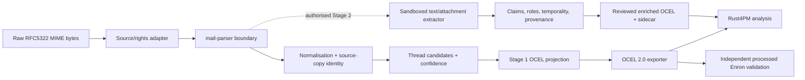

# Architecture and design — v0.1

## Bounded contexts and pipeline

## Crate boundaries (proposed, not implemented)
- `email-ocel-core`: source envelope, message identities, typed data contracts, deterministic IDs, privacy controls.
- `email-ocel-ingest`: safe EML/maildir input and incremental manifests; optional EDRM manifest adapter.
- `email-ocel-threads`: RFC references-based threading + explicit heuristic hypotheses; confidence independent of communication timestamps.
- `email-ocel-ocel`: map typed events/objects/relationships into Rust4PM's canonical full OCEL representation; export/import and loss ledger.
- `email-ocel-cli`: local offline commands `inspect`, `ingest`, `export-ocel`, `validate`, `benchmark`.
- `email-ocel-semantics` (feature optional): content segmentation, extractor traits, claim/evidence sidecar, human review.
- `email-ocel-evidence` (feature optional): temporal provenance graph adapter and retrieval/GraphRAG. No graph dependency for core.

Avoid publishing many tiny crates before interface pressure justifies them: begin with one Rust workspace with core+CLI and split into above crates as stable boundaries emerge. `process_mining` is an internal provider behind `OcelEngineAdapter` for compatibility. Use Polars/Arrow only for optional bulk analytics, not mandatory for parsing.

## Stage 1 object/event ontology
- `SourceCopy` = observed file/archival occurrence (same logical email may appear in many custodians). `Message` = logical email candidate. `PersonIdentity` = address/name assertion, not necessarily unique person. `Conversation` = thread hypothesis. `Attachment` = observed MIME part. `Document` = optional content-addressed document identity. `Mailbox`/`Folder` = observed provenance, not authorisation.
- One event `message_archived_observed` per source copy, timestamp `observed_at` (the archived-source observation); additionally, when a parseable header Date exists, a distinct `message_header_date_asserted` event is placed at **header_date** for reconstructing the claimed communication timeline. The latter is an assertion derived from source headers, not independent proof of sending or delivery. Query consumers must select an explicit event-view policy and may not silently mix ingestion and header times. Do not synthesise a delivery event. Optional evidence-backed `message_received_observed` only when source fields explicitly evidence reception.
- An archived copy links to `Message`, `SourceCopy`, `PersonIdentity` and `Attachment` objects with qualifiers `sender_asserted`, `to_asserted`, `cc_asserted`, `bcc_asserted`, `contains_mime_part`, `archived_copy`. A thread link is `in_reply_to_header` when actual header is available, otherwise `thread_candidate_subject`/`thread_candidate_quote` with confidence in sidecar.
- Preserve direction and multiplicity of relationships. Missing sender/recipient/message ID may be unresolved, but must not manufacture a named person or erase the record.

## Timing and identity
- Four clocks: `header_date`, `source_received_at` (nullable), `observed_at`, `processing_time`. Stage 2 adds `asserted_event_time` and `valid_time` separately.
- Scope the cryptographic ID fingerprint by type/domain/version; prefer content-hash plus custodian source refs for copies; logical-message linkage uses documented matching algorithm with collision handling. `Message-ID` is non-unique and can be absent or spoofed.
- Deterministic ordering by time plus stable canonical ID with explicit null handling. Keep original timezone offsets and round-trip UTC normalization with no silent truncation.

## Text content and attachments
- Parsing Stage 1 observes metadata only, with no attachment execution and no content emission to the public OCEL beyond approved/minimised attributes. Stage 2 is opt-in; enforce file size and expanded-size ceilings, MIME depth, charset normalization and safe parser selection.
- Extract top-authored text, quote blocks, forwarded content and signatures as **separate spans**. Never discard original bytes from the approved private source store; do not duplicate them into logs.
- Attachment content converters (PDF/DOCX/HTML/OCR) are optional sandboxed providers. Never fetch linked content or embedded remote resources.

## Stage 2 semantic contract
- Recognise `Claim`, `RequestedAction`, `Commitment`, `Deadline`, `DecisionCommunicated`, `ReportedCompletion`, `EvidenceReference`, `AmbiguousEntity`, `WorkflowCandidate`.
- Every semantic event references source-message fingerprint and protected source span (offset and content hash, not content in public repository), extraction strategy/version, quoted/author attribution, modality, negation, claimed-event time, confidence, adjudication state.
- Only non-disputed, mapped, sufficiently evidenced projections enter enriched OCEL; OCEL exporter preserves Stage 1 provenance and never rewrites it. Sidecar preserves alternatives/contradictions even if projection omits them.

## OCEL and interoperability
- Keep fully populated OCEL 2.0 with full `process_mining` native structures; prevent use of slim/indexed mining projections as persistence. Test source/enriched logs with Rust4PM. Run separately allowed PM4Py validation if rights/licensing permit.
- Verify standard JSON/XML/SQLite format support by actual API version before coding; record unsupported format features and explicit loss ledger rather than promising format parity.
- Version all schemas and mapping specs. A change to event type or qualifier requires migration test and changelog.

## Threat model
- Email bytes are attacker-controlled: malformed MIME/charset, HTML remote resources, zip/decompression bombs, executable documents, malicious prompts, large header fields, resource exhaustion, path traversal, symbolic links, duplicates and deliberately forged references.
- No execution/network retrieval in parsing. Raw data stays out of Git and CI. Optional local models run sandboxed with zero egress and explicitly limited sources. Process claims cannot trigger workflow actions.
- Human and organisational analysis is sensitive. No workforce scoring; privacy review required for real personal data. Do not assert operational completeness when source archive is incomplete.

## Portability
- Targets: Linux x86-64, Windows x86-64, macOS arm64. Pure Rust core where possible; test all in CI once qualified. No required Python, system OpenSSL, Office, Microsoft tenant, CUDA or Power Platform.
- Standard OCEL interoperability is engine-neutral. Sole active owned consumer: foi-process; no reverse compile-time coupling.

## Architecture decisions
- ADR-0001: independent project, not CareOps submodule.
- ADR-0002: raw-first Stage 1, immutable observation separate from interpretations.
- ADR-0003: Rust4PM as canonical OCEL; no mandatory Python process mining.
- ADR-0004: Enron datasets are evaluation corpora, rights and population matching required.
- ADR-0005: Conductor upstream registered as pinned Git submodule and project-owned plans checked in.

## Incremental structural NLP (after safe content access, before business-event NLP)

The intervening **Stage 1.5** is specified in [STRUCTURAL-EMAIL-NLP.md](STRUCTURAL-EMAIL-NLP.md). It annotates functional body zones, signatures, salutations and in-text person mentions without performing business-activity classification. This yields two independent representations: authoritative Stage 1 transport/header relationships and inferred, source-anchored Stage 1.5 text relationships. Quoted speech is attributed to its original reported speaker where possible and **not** counted as a new event. Every zone is recoverable by decoded-part byte offsets and hash; removed-from-analysis does not mean removed-from-evidence. Stage 2 speech-act classification is utterance-level and may assign multiple labels, unlike a coarse one-label-per-email classifier. Header roles and task responsibility remain different concepts.

## 0.2 refinement and alternatives
Read [FRONTIER-DESIGN.md](FRONTIER-DESIGN.md) for the extension design and [REPOSITORY-REUSE.md](REPOSITORY-REUSE.md) for inspected integration candidates. Selected: bounded Rust core with opt-in enrichment, not a monolithic LLM or CareOps component. Begin with core+CLI; the other crate names above are conceptual boundaries and are split only at the named implementation tasks. No graph UI or extra submodule is required.

The task manifest is now task-ID-based and acyclic. Safe body decoding/zoning does not wait for corpus benchmarking or OCR. Core release does not wait for research or optional consumer adapters. Optional OCEL 2.1 interchange is outside the required 2.0 contract.

## Selected product/consumer/retrieval refinement
The core outcome remains a Rust email-to-OCEL converter, with Enron only a canonical example/verification profile. The planned package names use Mailweft without changing existing schema IDs. The legacy foi-process pipeline is unvalidated and excluded from all correctness references. FOI acquisition, archive, consumer and ontology feedback responsibilities are in FOI-BOUNDARIES.md. Optional source-constrained GraphRAG is specified in GRAPHRAG.md and track 13; its retrieval graph is derived, not the authoritative source or event store. No graph requirement is added to default conversion or core release.

## Implemented package layout

The native checkpoint uses `crates/mailweft-core` and `crates/mailweft-cli`; logical components are internal modules. Earlier single-directory paths are superseded by this tested two-package layout. Stable schema IDs are unchanged. See docs/CORE-CHECKPOINT.md for actual status and unresolved security gates.
